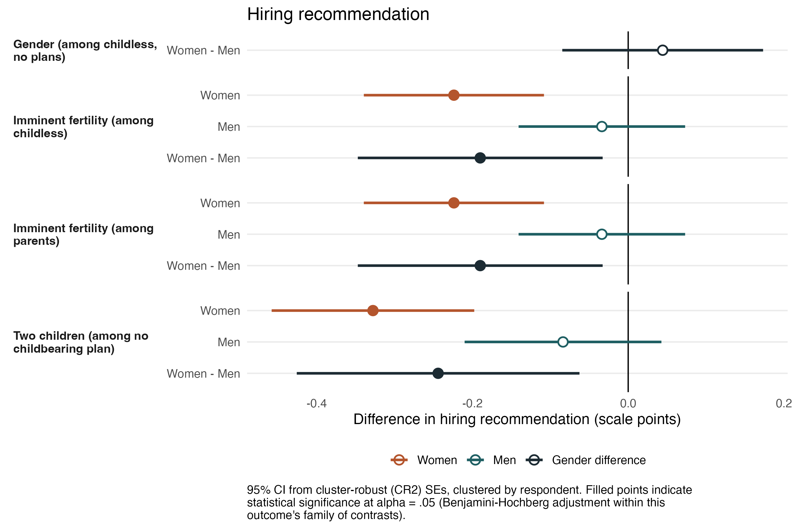
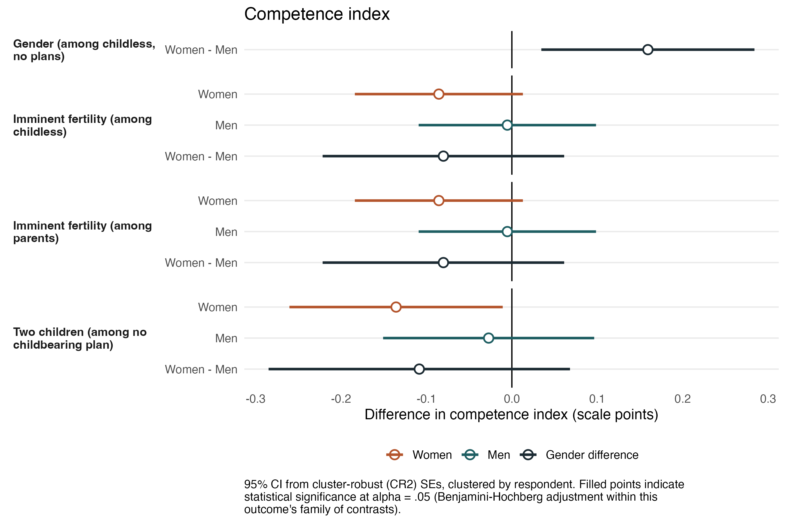
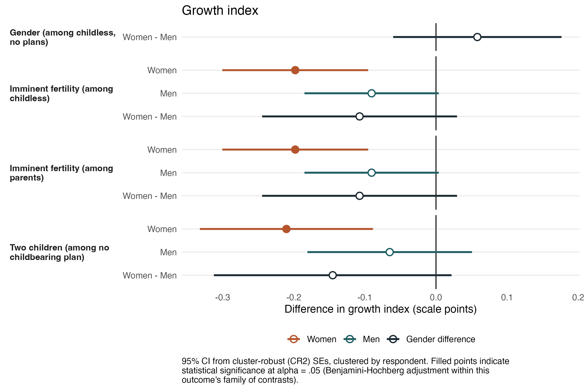
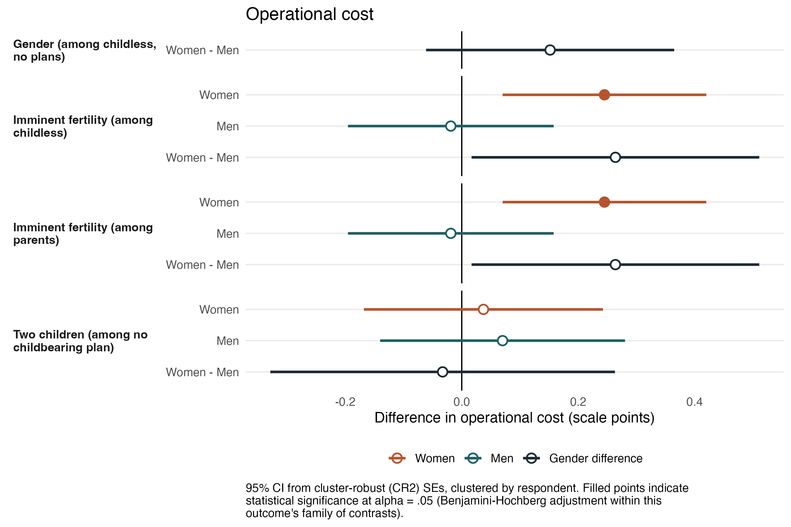
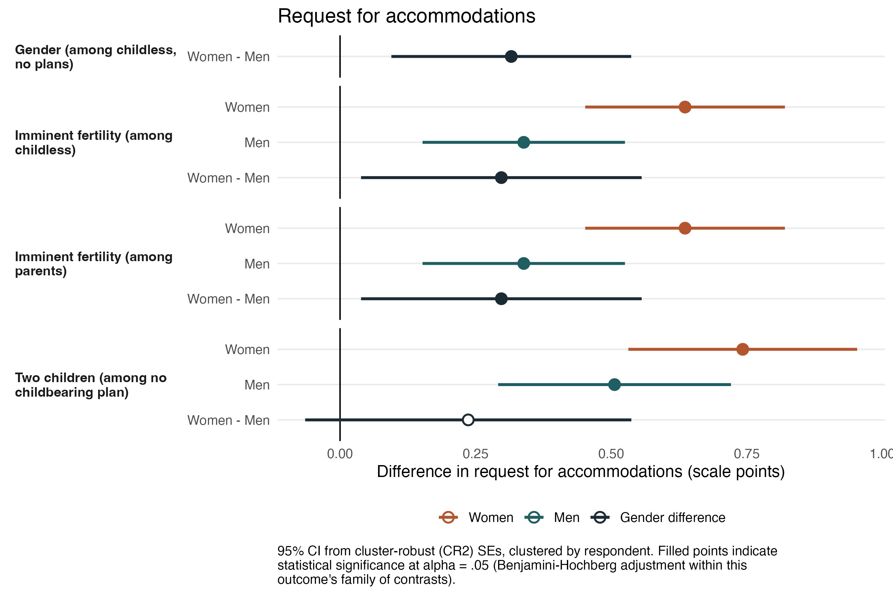
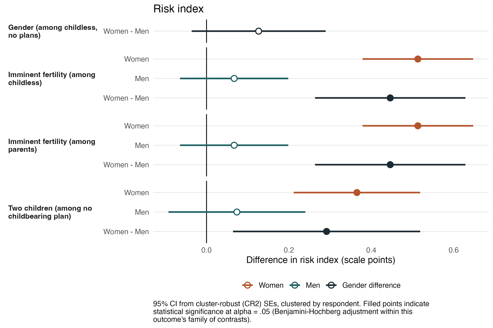
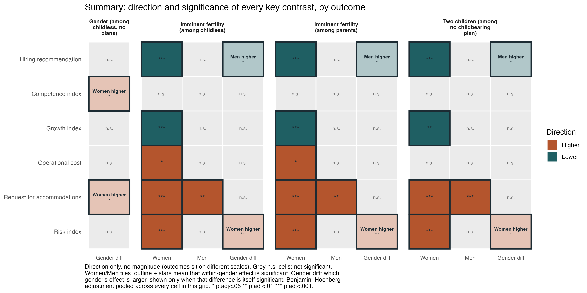
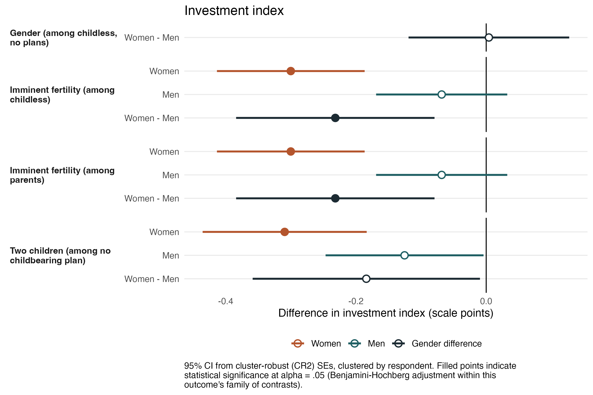
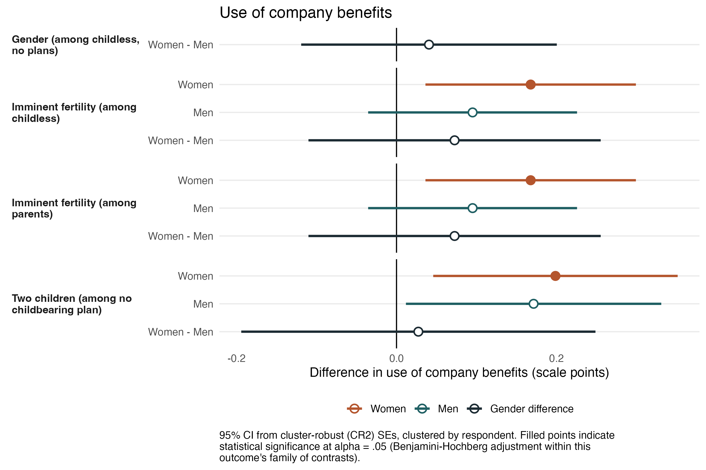
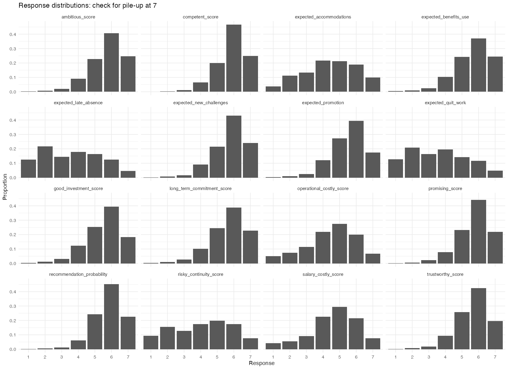

## Motivation {.section-title}

Motherhood in labor market research is often conceptualized as a dichotomy: we compare the evaluations and labor market outcomes of childless women with those of mothers'.

This overlooks a **forward-looking dimension**. Employers do not only assess who a candidate is now; they forecast who she is likely to become.

**Future fertility and family plans:** women may be evaluated not only in relation to their current parental status, but also in relation to how likely it is that they will a have child in the near future.

::: incremental
- Supply side: fertlity expectations shape women's work and family aspirations [(e.g. Bass 2015; Thébaud and Taylor 2021)]{.cite}.

- Demand side: employer's fertility expectations could shape hiring preferences against women who are likely to have a child in the short term [(e.g, Becker et al. 2019; Peterson et al. 2022)]{.cite}.
  - And unlike current motherhood, it is prospective and unverifiable: a judgment about anticipated rather than observed behaviour, which women cannot easily contest.

:::

::: notes
as a dichotomy: women either have no children or they are mothers.

Potential fertility applies to men and women, with or without children: e.g. Mothers who are seen as "done" with childbearing might be perceived differently than mothers of one who are seen as likely to have another baby.
:::

------------------------------------------------------------------------

## Why the distinction matters theoretically

Distinguishes what is attributable to **current caregiving** from what is attributable to **anticipated childbearing**. 

Motherhood stereotypes concern **current performance and costs already incurred**. Potential fertility concerns **assumptions about future behaviour**.

::::: two-col
::: {.claim .fragment}
**Anticipatory statistical discrimination**

[(Phelps 1972; Aigner and Cain 1977)]{.cite}

Employers forecast the expected costs and risks of anticipated childbearing — leave, disruption, turnover — and attach them to individual women.

→ Penalties on how **costly** and **risky** applicants are perceived to be, regardless of current motherhood status.
:::

::: {.claim .fragment}
**Status-based devaluation**

[(Ridgeway and Correll 2004; Correll et al. 2007)]{.cite}

Motherhood operates as a status characteristic: it activates diffuse expectations about professional standing.

→ Penalties on **growth potential** and **competence**, which could be exacerbated with future childbearing.
:::
:::::

::: notes
Not all childless women benefit equally from not being mothers, and not all mothers are penalised equally for motherhood.
Status:
Where anticipated childbearing is layered onto current motherhood, it activates diffuse expectations about professional standing.
This might be occuring through two main mechanisms:
:::

------------------------------------------------------------------------

## Research questions

> What stereotypes do employers associate with the **potential fertility** and **current motherhood status** of women job applicants in Chile?

> Do men experience similar penalties?

------------------------------------------------------------------------

## The case of Chile

::: incremental
- Chile has a history of **maternalist policies**: long maternity leave, almost no paternity leave, and childcare provision attached to women employees only.

- Women's participation in the labor force has stalled in the past decades, currently at 53.7% (Men: 71.3%). Particularly high female unemployment rate of 10.9% (Men: 8.7%).

- Historic (and globally) low fertility rate of 0.99 births per woman.

- Current policy debates around increasing fertility and changing employment policies regarding childbearing (such as universal day care).

:::

::: notes
Efforts to include women in under represented industries, quota for high level roles like executive boards, among other efforts.

Sala cuna: firms with 20 or more female employees must provide or fund childcare. The threshold creates a discrete hiring disincentive at the margin, and the cost attaches to hiring a woman rather than to being a parent.

Parental postnatal leave is formally transferable to fathers, but between 2011 and 2016 only 0.24% of eligible male workers used it. Paternity leave itself is five days.

This is the institutional reason to expect employers to price anticipated fertility, and to price it asymmetrically. It is also why the Chilean case is not simply a replication of US findings in a new setting.
:::

------------------------------------------------------------------------

## Data

Preregistered factorial survey experiment with 1449 individuals currently employed in supervisory or managerial level jobs in Chile. 

Respondents evaluated two applicants for a vacancy presented by a fictional human resources firm (2,898 obs). 

Six attributes vary at the profile level:

| Attribute | Levels |
|----|----|
| Gender | woman / man |
| Marital status | single / married |
| Parental status | no children / one child / two children |
| Family plans | in 2 years / in 5 years / does not want children |
| Experience | 6 / 7 / 8 years |
| Performance on a technical test | 5.8 / 6.0 / 6.3 |

Potential fertility was signalled by the **family plans** attribute, crossed with parental status. This separates current motherhood from anticipated fertility as distinct experimental factors.

::: notes
Parental status and family plans were presented as a single sentence, so that for applicants who already have children the plan is explicitly for another child: "has one child and would like to have another in two years."

Marital status was also folded into that sentence. Names were drawn from a fixed set — two female, two male — and assigned with a per-block flip so that a given name is not correlated with the position in which the profile appeared.
:::

---

## Design

::::: two-col
::: {.claim .fragment}
**Design**

- Vignette-based, rating outcomes
- D-efficient fractional design
- 200 unique profiles, 100 blocks of 2
- Each block assigned to ~14 respondents 

:::

::: {.claim .fragment}
**Efficiency**

- D-efficiency = 0.922
- G-efficiency = 0.925
- 28 model parameters, all identifiable

:::
:::::

**Presentation order and wording template are within-subject and fully crossed**. Both are controlled in all models.

::: note-line
Design, hypotheses and analysis plan preregistered at AsPredicted #297542 prior to data collection.
:::

::: notes
The design was optimised for a model that already contains the three-way interactions — gender × parental status × family plans, and gender × marital status × parental status — not only main effects. That is 28 parameters. The theoretical minimum was 90 profiles; 200 were used, so the design is deliberately over-specified.

Orthogonality was checked following Auspurg and Hinz: the maximum correlation between distinct terms in the model matrix is below the 0.05 threshold. Correlations within a term are higher, but that is arithmetic from sum coding for three-level factors, not confounding between dimensions.

Blocks were formed with optBlock and are close to orthogonal to the treatments, so which pair of profiles a respondent saw is unrelated to what those profiles contained.

getting about 92% of the precision an ideal design would give you, so almost nothing was lost by showing 200 profiles instead of the full set of possible combinations.
; G asks how bad the single least precisely estimated prediction is. A high G means no particular combination of attributes is badly served.
:::

------------------------------------------------------------------------

## Between- and within-subject structure

**Type of occupation is between-subjects.** Each respondent evaluated profiles of either professional or technical applicants only.

- Professional arm: financial associate, degree in business engineering
- Technical arm: accounting analyst, technical qualification in accounting
- Moderation tests find no evidence that occupational level conditions the main effects.

**Results presented here are from the pooled sample.**

::: notes
Order and template are balanced against each other and uncorrelated with every manipulated dimension, so neither can absorb a treatment effect.

The two occupations were chosen to hold the field constant — both are accounting and finance roles — while varying credential level. This is an occupational-credential contrast, not a class-position measure.
:::

------------------------------------------------------------------------

## La tarea que los participantes vieron

::: vignette
#### POSTULANTE A

#### Antecedentes profesionales

- [Marcela]{.slot} cuenta con [7 años]{.slot} de experiencia laboral continua en el ámbito de la contabilidad y las finanzas.
- Posee [Título profesional en Ingeniería Comercial]{.slot} y actualmente trabaja como [Asociada financiera]{.slot}.

#### Trayectoria laboral

A lo largo de su trayectoria profesional, se ha desempeñado tanto en el sector público como en el privado, participando en actividades relacionadas con el seguimiento de información financiera, la elaboración de reportes y la participación en procesos de planificación. En sus cargos anteriores, Marcela asumió responsabilidades de complejidad creciente, incluyendo el manejo de información financiera diversa, la comunicación con distintas áreas de la organización y el apoyo a equipos de trabajo.

#### Notas del entrevistador

- Indicó que valora el orden de los procesos internos de la empresa y la posibilidad de continuidad dentro de la organización.
- En el ámbito personal, Marcela [se encuentra casada, tiene un hijo y le gustaría tener otro en 2 años más]{.slot}.
- Marcela expresó su interés en integrarse a una organización de gran tamaño, con proyección que le permita continuar desarrollándose laboralmente.

#### Desempeño en test de habilidades técnicas

La nota necesaria para aprobar era un 5.0 y Marcela aprobó con [6.0]{.slot}.
:::

::: note-line
El texto destacado marca los atributos manipulados. Todo lo demás se mantuvo constante entre perfiles. Se usaron dos redacciones de este template, cruzadas con el orden de presentación.
:::

::: notes
Read one or two of the highlighted slots aloud rather than the whole vignette — the audience only needs to see that the family signal sits in the interviewer notes, alongside neutral material about process preferences and career interest, rather than being the obvious focus of the profile.

The surrounding text is deliberately bland and identical everywhere: the aim is that the manipulated attributes are the only thing that varies.

Note that the family sentence carries three manipulations at once — marital status, parental status, and family plans — which is what allows current motherhood and anticipated fertility to be read as distinct signals in the same sentence.
:::

------------------------------------------------------------------------

## Outcomes

**Nine outcomes**, all on 7-point scales. Third-order evaluations.

::::: three-claim
::: {.claim .fragment}
**Evaluation**

Hiring recommendation

Good investment

**Competence index** 

  - Capable

  - Trustworthy

  · $\alpha = .76$

**Growth index**

  - Promising

  - Ambitious

  - Take on new challenges

  - Be promoted

  · $\alpha = .84$
:::

::: {.claim .fragment}
**Cost**

- Operationally costly

- Requests accommodations

- Uses company benefits

$\alpha = .51$ — below threshold, analysed as separate items
:::

::: {.claim .fragment}
**Risk**

**Risk index** 

  - Committed long-term (reversed)

  - Late or absent
  
  - Resign
  
  - Risky for continuity 
  
  · $\alpha = .71$
:::
:::::

::: note-line
**Preregistered rule.** Items aggregate into indices where Cronbach's $\alpha \geq .70$; otherwise they are analysed individually.
:::

::: notes
The cost items did not meet the threshold, so they are reported separately rather than forced into an index. That decision rule was preregistered before the data came in — worth saying, because the cost items turn out to behave differently from one another, and analysing them separately is what makes that visible.

Note that long-term commitment is reverse-coded inside the risk index, so that higher always means riskier.
:::

------------------------------------------------------------------------

## Estimation

**OLS with cluster-robust standard errors (CR2), clustered by respondent.**

Models pool the two occupational conditions, with occupational level as a control.

Results reported as **marginal means and contrasts** rather than coefficients [(Leeper, Hobolt and Tilley 2020)]{.cite}.

Whether a penalty is **gendered** is tested as a difference-in-differences.

::: notes

Estimating **sum contrasts**, so coefficients are deviations from the design mean rather than differences from a certain reference level.

**Clustered standard errors.** Each person rated two profiles, so those ratings are not independent — a generous rater is generous twice. Clustering treats each respondent as one unit of independent information. CR2 is the small-sample correction; with 1,449 clusters we are far from needing it, which is worth saying if asked.

**Why not multilevel.** With only two profiles per respondent, random slopes are not identified — you cannot estimate a person-specific effect from two observations. And every manipulated attribute is already in the model as a fixed effect, so there is little left for a random effect to absorb.

**Sum contrasts.** Instead of comparing every level to one arbitrary reference category, each level is expressed as a deviation from the overall design mean. Two consequences: no level is privileged as "the baseline", and for a two-level factor like gender the coefficient is HALF the gap between women and men. That is exactly why I report marginal means instead.

**Marginal means.** Take the whole dataset, pretend every profile is a man, predict, average. Then do it again pretending every profile is a woman. The difference is the gender effect, holding the real distribution of every other attribute fixed. It is not the average rating men actually received — that would mix in whatever else happened to co-occur with being male.

I average over the observed sample rather than a balanced grid, because the D-efficient design only contains 200 of the possible attribute combinations. A balanced grid would predict for profiles nobody ever saw.

**Difference-in-differences.** "Significant for women, not for men" is not a test of whether the penalty is gendered. The gendered claim requires one estimate with its own standard error — the women's contrast minus the men's contrast.
:::

------------------------------------------------------------------------

## How results are reported 

Each figure shows the same four blocks of contrasts, for each outcome:

| Block | Comparison |
|------------------------------------|------------------------------------|
| **Gender, no family** | Women vs. men, among childless applicants stating no plans - "pure" gender penalty |
| **Imminent fertility, childless** | Childbearing plans in 2 years vs. no plans — women, men, difference - future motherhood penalty |
| **Imminent fertility, parents** | Childbearing plans in 2 years vs. no further plans — women, men, difference - additional child penalty |
| **Parenthood, no fertility plans** | Two children vs. none — women, men, difference - "pure" motherhood penalty |

Filled points represent statistical significance (Benjamini-Hochberg adjustment).

------------------------------------------------------------------------

## Two contrasts not shown in the figures

To ease readibility of the figures, I will not present two contrast that are null for almost all outcomes.

**A five-year horizon carries no penalty** on any outcome, with a single exception on long-term commitment.

**One child carries no penalty.** Overall, no evidence of penalties for "one child and done", except for the perception that the applicant will request accommodations.

> I will return to these findings in the discussion.

::: notes
Therefore, here I present the contrast between imminent fertility (plans in 2 years) and no plans.

no evidence of penalties for "one child and done" (among applicants with no plans to have another child)
The motherhood penalty only clearly appears between the first child and the second.
:::
------------------------------------------------------------------------

# Evaluations of the applicant {.section-divider}
------------------------------------------------------------------------

## Hiring recommendation {.figure-slide}

::: figure-frame
{fig-align="center" width="78%"}
:::
::: notes
The hiring recommendation is reduced by **imminent fertility** and by **motherhood at two children** — but not by gender alone, and not by a first child.

Both penalties are **specific to women**. For men, neither stating imminent plans to have a baby nor existing children moves the recommendation.

Perceptions on how **good of an investment** the applicant is, behaves almost identically as the hiring recommendation.
:::

------------------------------------------------------------------------

## Competence index {.figure-slide}

::: figure-frame
{fig-align="center" width="78%"}
:::
::: notes
There is no evidence of a competence penalty for women, future mothers, or mothers. There are no gender difference in these contrasts either.

The one movement is at the baseline: with no family signal, women are rated **slightly more competent** than men. This is mostly driven by perceptions of higher reliability/trustworthiness of women.
:::

------------------------------------------------------------------------

## Growth index {.figure-slide}

::: figure-frame
{fig-align="center" width="78%"}
:::
::: notes
Women are penalised on perceived growth potential by imminent fertility (both among childless and mothers), and by motherhood at two children. There is no evidence of these penalties for men.
The gender differences are **not statistically significant** as differences-in-differences. The claim the evidence supports is that growth potential is reduced for women by both mechanisms, not that it is reduced *more* for women than for men.
:::

# Prospective behavior {.section-divider}

------------------------------------------------------------------------

## Operational cost {.figure-slide}

::: figure-frame
{fig-align="center" width="78%"}
:::
::: notes
Imminent fertility among childless women and mothers is associated with higher operational costs.

Neither of these affect evaluations of men's operational cost.

Perceptions of higher organizational cost are not activated for mothers who are "done" with childbearing.
:::

------------------------------------------------------------------------

## Requests for accommodations {.figure-slide}

::: figure-frame
{fig-align="center" width="78%"}
:::
::: notes
Every comparison raises the expectation that the applicant will request accommodations: being a woman, imminent fertility among childless applicants and among parents, and parenthood itself.
It is also the only dimension where there is evidence of penalties for **men**.
No gender difference here is statistically significant. For both men and women, family signals activate anticipations about accommodations needs.
**Use of company benefits** behaves similarly, though less consistently across comparisons.
:::

------------------------------------------------------------------------

## Risk index {.figure-slide}

::: figure-frame
{fig-align="center" width="78%"}
:::
::: notes
Women are rated as riskier by imminent fertility — with or without existing children — and by motherhood at two children.
Regardless of family signals, the perceived risk of men is stable.
On this dimension, **every gender difference is statistically significant**.
:::

------------------------------------------------------------------------

## Summary {.figure-slide}

::: figure-frame
{fig-align="center" width="88%"}
:::

::: note-line
Direction only, not magnitude — outcomes sit on different scales.
:::

::: notes
READING THE TABLE — walk the columns left to right.

Column 1, gender with no family signal. Almost empty. Two cells only: women are seen as more likely to request accommodations, and — going the other way — slightly more competent. Nothing on hiring, growth, cost or risk. Point at the blank hiring cell: with no family information, there is no gender gap in the recommendation.

Columns 2 and 3, imminent fertility among childless women and among mothers. These two columns are near-identical. That is the finding: it does not matter whether she already has children. Every row lights up except competence.

Column 4, two children with no further plans. Same shape as columns 2 and 3, with one cell missing — operational cost. Motherhood does not raise the perceived cost of the applicant; anticipated childbearing does.

The competence row is empty everywhere except the first column. No penalty reaches competence.
The accommodations row is full everywhere — and it is the only row where the men's cells are also filled.
Every other men's column is blank.
:::

# Discussion {.section-divider}

------------------------------------------------------------------------

## Conclusions I — three penalties, three patterns

::::::: three-claim
::: {.claim .fragment}
**Gender alone**

Does **not** reach the hiring recommendation. With no family signal, the only trace is that women are still expected to request accommodations more than men.
:::

::: {.claim .fragment}
**Anticipated fertility**

Penalises childless women and mothers **alike**, and reaches every outcome except perceived competence.

Concerns activate **only when fertility is imminent** — no clear penalties for longer-term plans (5 years).
:::

::: {.claim .fragment}
**Current motherhood**

Penalised **only at the second child**. No evidence that "one and done" mothers are penalised.

A notable finding in a context of rising one-child families in Chile.
:::
:::::::

::: note-line
The penalty attaches to the anticipated birth, not to the applicant's current status.
:::

------------------------------------------------------------------------

## Conclusions II — what separates the two mechanisms

::::: two-col
::: {.claim .fragment}
**Operational cost**

Motherhood does **not** raise perceived operational cost; imminent fertility does.

→ The concern focuses around **pregnancy and maternity leave**, not ongoing caregiving.
:::

::: {.claim .fragment}
**Competence**

Evaluators do **not** judge these applicants as less capable or less trustworthy — not what a status-based account of the motherhood penalty predicts [(Correll, Benard and Paik 2007)]{.cite}.

→ The explanation shifts from inferences about **ability** toward normative expectations about **who absorbs the costs of care** — in Chile today, gender stereotypes appear to operate through other perceptions, not through competence itself.
:::
:::::

::: {.takeaway .fragment}
In the Chilean case, those expectations are reinforced by a family policy regime that attaches leave and benefits primarily to mothers.
:::

------------------------------------------------------------------------

## Conclusions III — where the asymmetry lies

Family signals raise the expected use of accommodations for **both women and men**.

::: {.takeaway .fragment}
But the negative associations that follow from those accommodations are placed **solely on women** — being costlier, having less growth potential, and being riskier.
:::

::: notes
This is the sharpest way to state the gendered result. It is not that employers fail to notice that men also have families — the accommodations row shows they do. It is that only for women does an anticipated claim on the organisation get converted into cost, risk, and diminished growth potential.
:::

------------------------------------------------------------------------

## Work in progress! Next steps:

::: {.claim .fragment}

- Attention-check sensitivity analysis: full vs. restricted sample
- Additional robustness tests: response time, time in task, etc.
- Moderation by evaluator characteristics: gender, parental status, industry, job level, workplace-norm attitudes
- Interactions with applicants' marital status and achievement test

:::

------------------------------------------------------------------------

##  {.thank-you}

**Thank you!**

tania.hutt@uc.cl

------------------------------------------------------------------------

## Appendix: good investment {.appendix .figure-slide}

::: figure-frame
{fig-align="center" width="78%"}
:::

------------------------------------------------------------------------

## Appendix: use of company benefits {.appendix .figure-slide}

::: figure-frame
{fig-align="center" width="78%"}
:::

------------------------------------------------------------------------

## Appendix: does occupational level moderate the penalties? {.appendix}

Preregistered moderation tests find no evidence that occupational level conditions the focal effects.

::::: columns
::: {.column width="55%"}
- Gender × occupation: no coefficient exceeds $|0.052|$ across outcomes
- Confidence bounds exclude moderation greater than **0.14 scale points**
- Heterogeneity across arms: Cochran $Q = 306.2$, $df = 285$, $p = .185$

:::

::: {.column width="45%"}
Pooling reduces standard errors by **29%**.
:::
:::::

------------------------------------------------------------------------

## Appendix: response distributions {.appendix .figure-slide}

::: figure-frame
{fig-align="center" width="72%"}
:::

------------------------------------------------------------------------

## Appendix: model sets {.appendix}

| Set | Specification | Used for |
|------------------------|------------------------|------------------------|
| SET 2a | Gender × Parental status | Motherhood contrasts |
| SET 2b | Gender × Family plans | Imminent fertility contrasts |
| Combined | Both two-way interactions | Gender contrast at no children, no plans |
| SET 5a–5e | Occupational level interactions | Appendix moderation |

All sets control for marital status, experience, test performance, occupational level, presentation order and template version. Estimated on the pooled sample with cluster-robust (CR2) standard errors.
------------------------------------------------------------------------

## References {.appendix}

::: references
Aigner, D. J., and G. G. Cain. 1977. "Statistical Theories of Discrimination in Labor Markets." *Industrial and Labor Relations Review* 30(2): 175–187.

Auspurg, K., and T. Hinz. 2015. *Factorial Survey Experiments*. Thousand Oaks, CA: SAGE.

Bond, T. N., and K. Lang. 2019. "The Sad Truth about Happiness Scales." *Journal of Political Economy* 127(4): 1629–1640.

Correll, S. J., S. Benard, and I. Paik. 2007. "Getting a Job: Is There a Motherhood Penalty?" *American Journal of Sociology* 112(5): 1297–1338.

Hainmueller, J., D. J. Hopkins, and T. Yamamoto. 2014. "Causal Inference in Conjoint Analysis: Understanding Multidimensional Choices via Stated Preference Experiments." *Political Analysis* 22(1): 1–30.

Leeper, T. J., S. B. Hobolt, and J. Tilley. 2020. "Measuring Subgroup Preferences in Conjoint Experiments." *Political Analysis* 28(2): 207–221.

Liddell, T. M., and J. K. Kruschke. 2018. "Analyzing Ordinal Data with Metric Models: What Could Possibly Go Wrong?" *Journal of Experimental Social Psychology* 79: 328–348.

Phelps, E. S. 1972. "The Statistical Theory of Racism and Sexism." *American Economic Review* 62(4): 659–661.

Pustejovsky, J. E., and E. Tipton. 2018. "Small-Sample Methods for Cluster-Robust Variance Estimation and Hypothesis Testing in Fixed Effects Models." *Journal of Business & Economic Statistics* 36(4): 672–683.

Ridgeway, C. L., and S. J. Correll. 2004. "Motherhood as a Status Characteristic." *Journal of Social Issues* 60(4): 683–700.
:::
