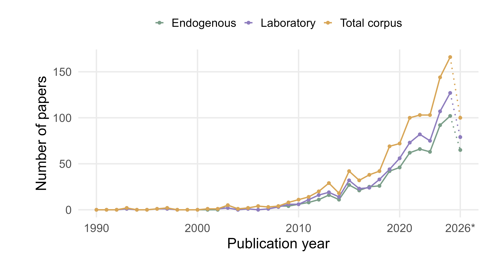
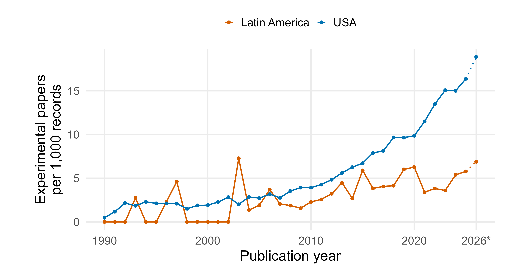
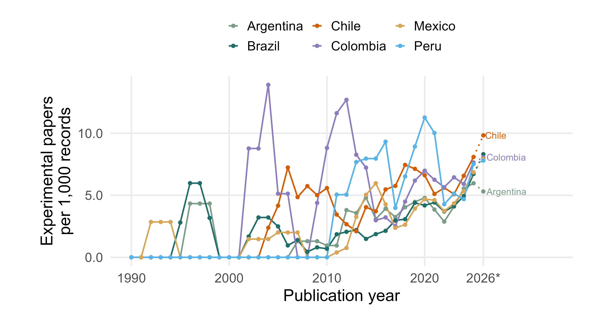
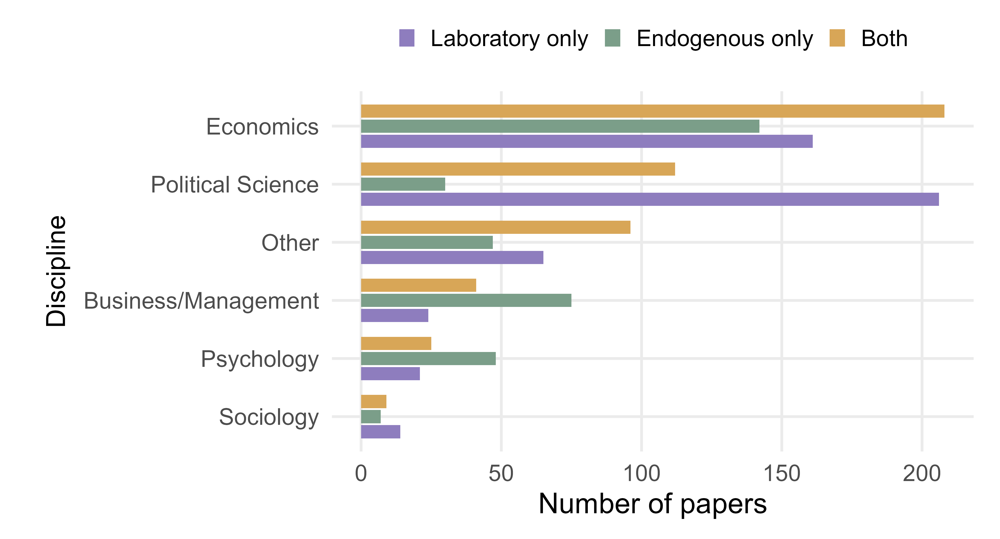
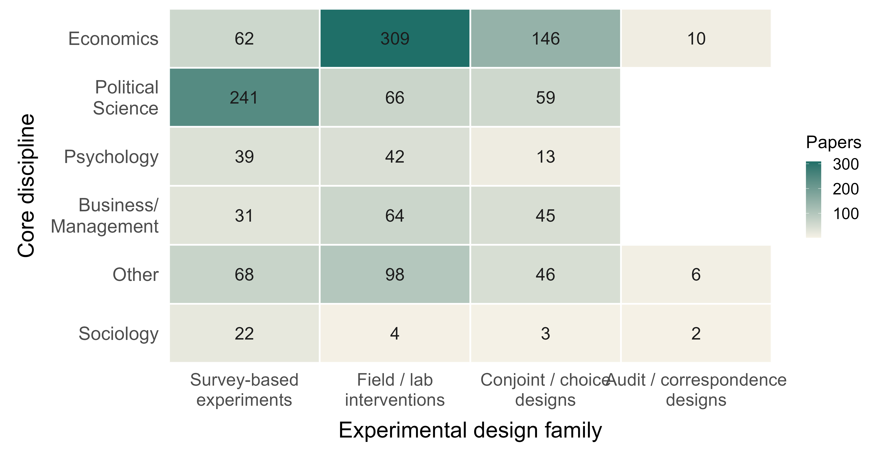
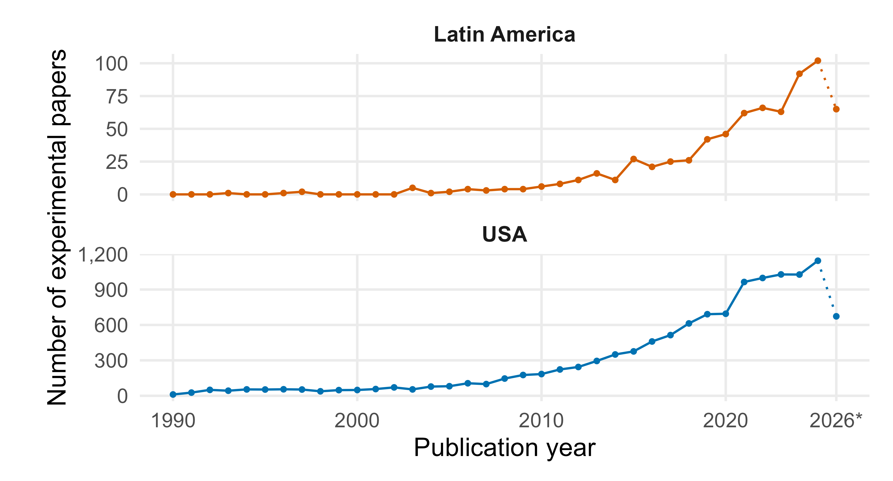
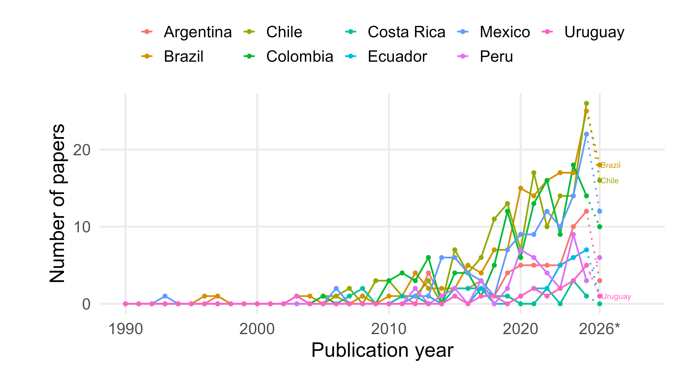
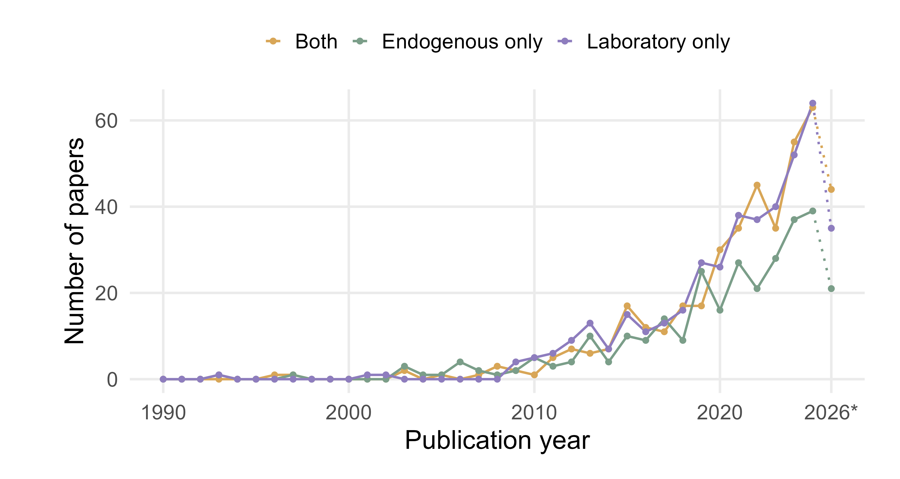

## Project context {.project-slide}

::: origin-main
This bibliometric review maps the regional context in which experimental designs are being developed: **where these studies are produced, what they study, and which methods they use.**
:::

::::::: origin-grid
::: origin-card
**Wider project**

FONDECYT in Female labor market discrimination in Chile, led by Tania Hutt.
:::

::: origin-card
**Design focus**

Motherhood and potential fertility penalties from supply and demand perspectives.
:::

::: origin-card
**This phase**

Mapping experimental research in and about Latin America.
:::

::: {.origin-card .accent}
**Purpose**

Building regional context for future experimental design.
:::
:::::::

## Guiding question and analytical steps {.guiding-slide}

::: guiding-question
Is Latin America becoming a producer of experimental social science, and how are these methods situated in the region?
:::

::::::: objectives-grid
::: objective-item
**1. Evolution**

Trace experimental production in Latin America over time (1990-2026).
:::

::: objective-item
**2. Relative presence**

Compare experimental output with total social science production in Latin America and the United States.
:::

::: objective-item
**3. Two dimensions**

Distinguish research produced with regional institutional participation from research about the region.
:::

::: objective-item
**4. Research profile**

Identify the disciplines, countries, and design families shaping the corpus.
:::
:::::::

## Search and coding decisions {.engine-slide .search-slide}

::::::: engine-layout
::: engine-panel
**Search universe**

Web of Science Core Collection, articles and early access records between **1990-2026**
:::

::: engine-panel
**Experimental signal**

Title, abstract, and keywords: *survey, field, conjoint, vignette, factorial, audit/correspondence, list, choice, and online experiments.*
:::

::: engine-panel
**Geographic scope**

Fourteen Latin American countries with enough WoS coverage (\>500 records) to support comparison across the period.
:::

::: engine-panel
**Disciplinary filter**

WoS categories regrouped into six analytical fields: Economics, Political Science, Sociology, Psychology, Business/Management, and Other (e.g. : Women Studies, Demography, Urban Studies)
:::
:::::::

## Two analytical dimensions {.dimensions-slide}

::::::: dimension-grid
:::: dimension-card
**Endogenous production**

At least one author has a Latin American institutional affiliation.

::: dim-note
This identifies regional participation in experimental research production.
:::
::::

:::: dimension-card
**Laboratory research**

The study focuses on Latin America in the title, abstract, or keywords, regardless of author location.

::: dim-note
This identifies research about the region as an empirical setting.
:::
::::
:::::::

::: slide-caption
The two dimensions **are not mutually exclusive**: a record can be both produced with Latin American institutional participation and focused on Latin America.
:::

## Corpus composition, 1990-2026 {.corpus-slide}

::::::: {.metric-row .corpus-metrics}
::: metric
**297**

Endogenous only
:::

::: metric
**421**

Laboratory only
:::

::: metric
**418**

Both
:::

::: metric
**1,136**

Total corpus
:::
:::::::

::: note-line
The total corpus deduplicates records across the endogenous and laboratory searches.
:::

## Search universes, 1990-2026 {.universes-slide}

::: figure-frame
{.click-zoom fig-alt="Annual records by endogenous search, laboratory search, and total deduplicated corpus"}
:::

::: slide-caption
The lines show different search lenses; 2026 is partial.
:::

## Relative output, 1990-2026 {.relative-slide}

:::::::: comparison-layout
:::: comparison-figure
::: figure-frame
{.click-zoom fig-alt="Experimental papers per 1,000 WoS social science records in Latin America and the United States"}
:::
::::

::::: comparison-table
**2025 snapshot**

::: snapshot-row
Latin America<strong>5.8</strong><small>102 / 17,648</small>
:::

::: snapshot-row
USA<strong>16.4</strong><small>1,144 / 69,863</small>
:::
:::::
::::::::

::: slide-caption
Rates are not raw volumes; 2026 is partial.
:::

## Country rates, 1990-2026 {.country-slide}

:::::: country-rate-layout
:::: country-rate-figure
::: figure-frame
{.click-zoom fig-alt="Endogenous experimental output per 1,000 WoS social science records in selected Latin American countries"}
:::
::::

::: country-output-table
**Endogenous by country**

| Country   | Papers |
|:----------|-------:|
| Brazil    |    163 |
| Chile     |    160 |
| Colombia  |    130 |
| Mexico    |    120 |
| Argentina |     65 |
| Peru      |     47 |
:::
::::::

::: slide-caption
Rates vary with publication bases; 2026 is partial.
:::

## Core disciplines, 1990-2026 {.discipline-slide}

::: figure-frame
{.click-zoom fig-alt="Core disciplines by endogenous-only, laboratory-only, and both search-status groups"}
:::

::: slide-caption
Search-status groups are mutually exclusive; WoS core areas can overlap.
:::

::: sociology-callout
**Experimental sociology:** Sociology represents 30 records in the total corpus, making the methodological discussion especially relevant for this audience.
:::

## Design families, 1990-2026 {.methods-slide}

::: figure-frame
{.click-zoom fig-alt="Experimental design families by core discipline"}
:::

::: slide-caption
Design families vary across core disciplines.
:::

::: method-note
Families: survey-based = survey, vignette, factorial, list, online; conjoint/choice = conjoint and choice; audit/correspondence = audit, correspondence, resume/CV.
:::

## Main points {.main-slide}

::::::: {.agenda-grid .compact-agenda}
::: agenda-item
**Country patterns**

Country-level rates should be read together with publication volume. They show heterogeneous trajectories, not a single Latin American pattern.
:::

::: agenda-item
**Disciplinary profile**

The corpus is uneven across core areas. Sociology is present but small, which makes the methodological discussion especially relevant for this audience.
:::

::: agenda-item
**Design families**

Experimental work is not methodologically uniform. Field/lab interventions, survey-based designs, conjoint/choice designs, and audit/correspondence designs organize different parts of the field.
:::

::: agenda-item
**Current limits**

The corpus is still being validated. WoS coverage varies, 2026 is partial, affiliation does not equal leadership, and country coding from titles, abstracts, and keywords requires manual checks.
:::
:::::::

## Next steps {.takeaways-slide}

::: closing-box
**Takeaways**

- The region should be treated simultaneously as a site of study, a site of production, and a space of collaboration.
- Rates and volumes answer different questions; both are needed to avoid overstating early or partial-year peaks.
- Search metadata gives us the map, but not yet the full social organization of the research field.

**Next steps**

- Complete record-level validation of abstracts, keywords, affiliations, and authorship roles.
- Map citation networks to examine diffusion, dependency, and bridges between endogenous and laboratory research.
- Use topic modeling to identify thematic clusters and connect them to design choices and regional constraints.
:::

## Appendix: Absolute experimental output, 1990-2026 {.appendix-absolute-slide}

::: figure-frame
{.click-zoom fig-alt="Absolute annual experimental papers in Latin America and the United States"}
:::

::: slide-caption
The absolute counts are shown in separate panels because USA volume is much larger. The 2026 point is partial and marked with an asterisk.
:::

## Appendix: Endogenous production by affiliation country {.appendix-country-slide}

::: figure-frame
{.click-zoom fig-alt="Endogenous experimental production by Latin American affiliation country and year"}
:::

::: slide-caption
Annual endogenous production is concentrated in a small group of affiliation countries, with different growth trajectories over time. The 2026 point is partial.
:::

## Appendix: Records meeting one or both search criteria {.appendix-status-slide}

::: figure-frame
{.click-zoom fig-alt="Annual records that are endogenous only, laboratory only, or meet both search criteria"}
:::

::: slide-caption
The 2026 point is partial. Before 2026, overlap grows, but endogenous-only and laboratory-only records remain substantial parts of the corpus.
:::

## Thank You {.thank-slide}

::: thank-you-box
**Valentina González Madariaga**

vsgonzalez2\@uc.cl

[Instagram: \@costo_de_maternar](https://www.instagram.com/costo_de_maternar/)

[LinkedIn: Costo de Maternar](https://www.linkedin.com/company/costo-de-maternar)
:::